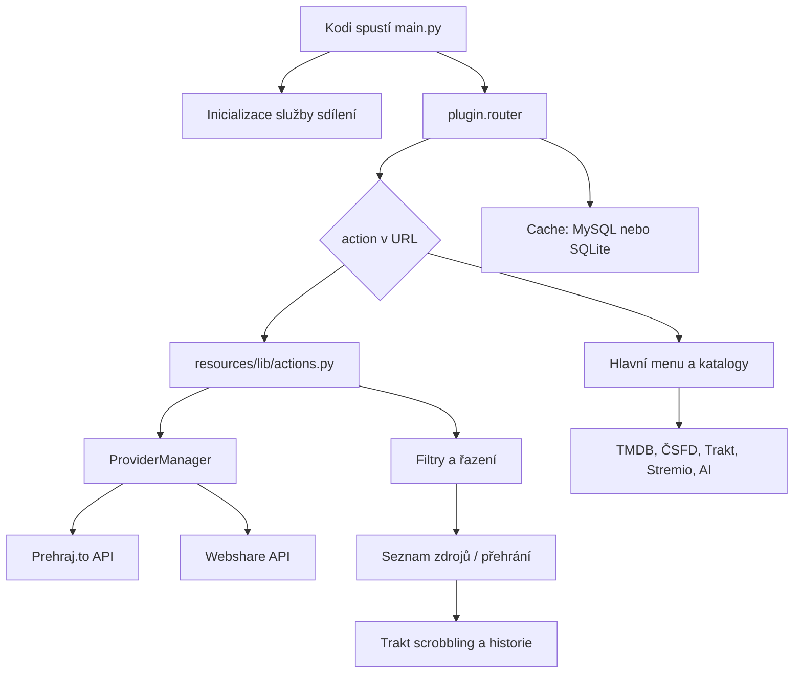

# KODI 22 PIERS : VIDEO ADDON

    # ============================================================================================= # 
    # == # ========================     X B M C  --  K O D I    2 2    P I E R S    ========== # == # 
    #    #                                                                                     #    # 
    #    #         _____ ____  __  __________  __      __________  ____  __ __                 #    # 
    #    #        / ___// __ \/ / / /_  __/ / / /     / ____/ __ \/ __ \/ //_/                 #    # 
    #    #        \__ \/ / / / / / / / / / /_/ /_____/ /_  / / / / /_/ / ,<                    #    # 
    #    #       ___/ / /_/ / /_/ / / / / __  /_____/ __/ / /_/ / _, _/ /| |                   #    # 
    #    #      /____/\_______________ /_/ /_/  ______  ___________|_/_/ |_|                   #    # 
    #    #         / | / / ____/_  __/ | |     / / __ \/ __ \/ //_/                            #    # 
    #    #        /  |/ / __/   / /____| | /| / / / / / /_/ / ,<                               #    # 
    #    #       / /|  / /___  / /_____/ |/ |/ / /_/ / _, _/ /| |                              #    # 
    #    #      /_/ |_/_____/ /_/      |__/|__/\____/_/ |_/_/ |_|   (TM) 2026 Mau!X ER . . .   #    # 
    #    #                                                                                     #    # 
    #    #                                                                                     #    # 
    # == # =================================================================================== # == # 
    # =============    [  P L U G I N . V I D E O . P L A Y _ E R  ]    =========================== # 

# | PLAY.ER |

"| PLAY.ER |"  je open‑source Kodi addon napsaný v Python3

Addon  **nehostuje žádný obsah**  a slouží pouze jako 
technický nástroj pro přístup k externím, veřejně dostupným zdrojům.

---

## License
This project is licensed under the **GNU General Public License v3 (GPL‑3.0)**.
You are free to use, modify and redistribute this addon under the terms of this license.

---

## Disclaimer
This addon does **not** host, store, upload or distribute any media files.
All content is provided by third‑party services and accessed at the user’s own responsibility.

The author is  **not responsible**  for the availability, legality or quality of external content.

---

## Donations
If you like this addon and want to support its development, you can make a  **voluntary contribution** :

- PayPal: https://paypal.me/
- BuyMeACoffee: https://buymeacoffee.com/
- GitHub Sponsors

Donations are  **optional**  and do not unlock any additional features.

---

## Source code
Source code is publicly available :
https://gitea.south-fork.uk/mauix/plugin.video.play_er

## Technická dokumentace a uživatelský manuál pro doplněk `plugin.video.play_er`

**Verze dokumentu:** 1.1 (2024-05-25)

Tento dokument slouží jako komplexní průvodce doplňkem, jeho architekturou, funkcemi a možnostmi nastavení. Je určen jak pro běžné uživatele, kteří chtějí plně využít jeho potenciál, tak pro vývojáře, kteří se chtějí seznámit s jeho interní logikou.

---

## 1. Základní filozofie: "Metadata-First"

Na rozdíl od mnoha jiných doplňků, které pouze najdou odkaz na video a přehrají ho, je tento doplněk postaven na principu **"Metadata-First"**. Jeho hlavním cílem je zajistit, aby přehrávač Kodi vždy obdržel co nejbohatší a nejpřesnější sadu metadat o přehrávaném obsahu.

**Proč je to důležité?**
-   **Integrace se skiny:** Moderní skiny (Arctic Horizon 2, Estuary MOD V2 atd.) dokáží zobrazit detailní informace o filmu/seriálu, ale pouze pokud je od doplňku dostanou.
-   **Integrace se službami:** Služby jako Trakt.tv potřebují přesné ID (TMDB ID, Trakt ID), aby mohly správně zaznamenávat historii sledování (scrobbling).
-   **Konzistence knihovny:** Zajišťuje, že se obsah správně zařadí a zobrazí v knihovně Kodi.

Doplněk tedy aktivně vyhledává metadata na **TMDB (The Movie Database)** a teprve s touto kompletní sadou informací hledá odpovídající streamy na serveru Prehraj.to.

---

## 2. Klíčové funkce a jejich princip

### 2.1. Vyhledávání a přehrávání

Když uživatel hledá film nebo seriál, doplněk provede následující kroky:

1.  **Normalizace dotazu:** Zadaný text (např. `Vetřelec 1979 cz dabing 1080p`) je nejprve "vyčištěn". Odstraní se z něj klíčová slova jako `cz dabing`, `1080p` a extrahuje se rok (`1979`). Výsledkem je čistý dotaz `Vetřelec` a rok `1979`.
2.  **Dotaz na TMDB:** S tímto čistým dotazem se doplněk zeptá TMDB na odpovídající film/seriál.
3.  **Sestavení `meta` balíčku:** Pokud TMDB vrátí přesný výsledek, doplněk si sestaví kompletní balíček metadat (`meta`), který obsahuje vše od názvu, popisu, žánrů až po obrázky a TMDB ID.
4.  **Hledání zdrojů na Prehraj.to:** Nyní doplněk prohledá server Prehraj.to.
5.  **Aplikace filtrů:** Na nalezené zdroje se aplikují **globální filtry** z nastavení (viz sekce 4.2).
6.  **Zobrazení výsledků:** Uživatel vidí seznam dostupných streamů. Každý z nich si s sebou interně nese kompletní `meta` balíček z kroku 3.
7.  **Přehrání:** Po kliknutí na stream se přehrávači Kodi předá nejen odkaz na video, ale i celý `meta` balíček, což zajistí správné zobrazení informací a funkčnost scrobblingu.

### 2.2. Funkce `AUTOLIST`

`AUTOLIST` je pokročilá funkce pro automatické vytváření playlistů. Její chování se liší pro filmy a seriály.

#### AUTOLIST pro FILMY

-   **Princip:** Vytvoří playlist filmů podobných tomu, který jste si vybrali.
-   **Postup:**
    1.  Uživatel si zapne `AUTOLIST` a vybere film.
    2.  Tento **startovní film** je přidán jako první do playlistu.
    3.  Doplněk se zeptá TMDB na seznam **doporučených filmů** (`/movie/{id}/recommendations`).
    4.  Prochází doporučené filmy a **kontroluje je proti historii přehrávání** (`playback_history.json`). Pokud byl film již viděn, je přeskočen a zobrazí se notifikace.
    5.  Pro každý nevyřazený film vyhledá zdroje a vybere jeden konkrétní stream podle nastavené **metody výběru zdroje** (viz sekce 3.2).
    6.  Pokračuje, dokud nedosáhne požadovaného počtu filmů v playlistu.

#### AUTOLIST pro SERIÁLY

-   **Princip:** Vytvoří sekvenční playlist následujících epizod v dané sérii.
-   **Postup:**
    1.  Uživatel si zapne `AUTOLIST` a vybere epizodu (např. `S02E05`).
    2.  Doplněk automaticky přidá do playlistu tuto epizodu a následující epizody ze stejné série (`S02E06`, `S02E07`, ...), dokud nedosáhne požadovaného počtu.
    3.  **Historie přehrávání se zde pro filtrování nepoužívá.** Playlist se vždy sestavuje sekvenčně.
    4.  Pro každou epizodu v playlistu se vybere jeden konkrétní stream podle nastavené **metody výběru zdroje pro seriály**.

### 2.3. Playback History (Historie přehrávání)

-   **Princip:** Každý film nebo epizoda, která se začne přehrávat, se okamžitě uloží do souboru `playback_history.json`.
-   **Chování:**
    -   Pokud přehráváte položku, která v historii ještě není, přidá se na první místo.
    -   Pokud přehráváte položku, která již v historii je, pouze se přesune na první místo (nevytváří se duplikáty).
    -   Seznam je omezen na počet položek nastavený v `NASTAVENÍ -> ZÁKLADNÍ`.
-   **Využití:** Primárně slouží jako **exclude list** pro `AUTOLIST` filmů, aby se neopakovaly již viděné tituly.

---

## 3. Nastavení výběru zdroje (AUTOLIST)

Tato nastavení (v sekci `AUTOLISTS`) jsou klíčová pro chování funkce `AUTOLIST` a jsou oddělená pro filmy a seriály.

### 3.1. `POVOLIT VÝBĚR ZDROJE`

-   **VYPNUTO:** Vždy se použije první dostupný zdroj, který server Prehraj.to vrátí. Jednoduché a většinou spolehlivé.
-   **ZAPNUTO:** Aktivuje pokročilé metody výběru.

### 3.2. `POUŽÍT METODU SELEKCE`

#### A) Metoda: `PRVNÍ DOSTUPNÝ`
-   **Chování:** Vybere první zdroj ze seznamu.
-   **Vhodné pro:** Běžné použití, kdy nechcete nic řešit.

#### B) Metoda: `PODLE POZICE`
-   **Chování:** Umožňuje nastavit preferovanou pozici ve výsledcích (např. vždy vybrat 3. zdroj). Pokud tolik zdrojů neexistuje, vybere poslední dostupný.
-   **Vhodné pro:** Situace, kdy víte, že první výsledky bývají z nějakého důvodu vadné a chcete je přeskočit.

#### C) Metoda: `INTELIGENTNÍ`
-   **Chování:** Toto je nejpokročilejší metoda. Na seznam nalezených zdrojů aplikuje **dedikované filtry** z nastavení (`EXPRESSION -> AUTOLIST`).
-   **Postup:**
    1.  Vezme všechny nalezené zdroje.
    2.  Aplikuje `EXCLUDE` filtry a striktně odstraní všechny nevyhovující zdroje.
    3.  Na zbývající zdroje aplikuje `INCLUDE` filtry jako **prioritizaci** (viz sekce 4.3).
    4.  Z tohoto finálně seřazeného a profiltrovaného seznamu vybere první položku.
-   **Vhodné pro:** Uživatele, kteří chtějí mít maximální kontrolu nad kvalitou a typem streamů v playlistu (např. upřednostnit 1080p a zároveň vyloučit 4K).

---

## 4. Filtry (Expression)

Sekce `EXPRESSION` v nastavení je mocným nástrojem pro ovlivnění toho, jaké zdroje se vám budou nabízet. Všechny filtry podporují více klíčových slov oddělených mezerou (např. `1080p 720p cz`).

### 4.1. Globální filtry (`INCLUDE` / `EXCLUDE`)

-   **Kde se používají:** Při **ručním vyhledávání** zdrojů pro film/epizodu a pro **startovní položku** v `AUTOLIST`u.
-   **`INCLUDE` (Prioritizace):** Zdroje obsahující některé z těchto slov budou **upřednostněny** (posunuty na začátek seznamu). Ostatní nebudou odstraněny.
    -   *Příklad:* `INCLUDE: 1080p` -> Zdroj `Film.2024.1080p.mkv` bude před zdrojem `Film.2024.720p.mkv`. Pokud 1080p verze neexistuje, použije se 720p.
-   **`EXCLUDE` (Striktní odstranění):** Zdroje obsahující některé z těchto slov budou **vždy odstraněny** ze seznamu.
    -   *Příklad:* `EXCLUDE: 4K 2160p` -> Všechny zdroje obsahující "4K" nebo "2160p" se nikdy nezobrazí.

### 4.2. Dedikované filtry pro `AUTOLIST`

Existují dvě sady těchto filtrů, jedna pro filmy (`AUTOLIST : INCLUDE`) a druhá pro seriály (`AUTOLIST : INCLUDE - SERIES`).

-   **Kde se používají:** Pouze při použití metody `INTELIGENTNÍ` v nastavení `AUTOLIST`.
-   **Chování:** Fungují na stejném principu jako globální filtry:
    -   `INCLUDE` slouží k **prioritizaci**.
    -   `EXCLUDE` slouží ke **striktnímu odstranění**.
-   **Účel:** Umožňují nastavit jiná, například přísnější, pravidla pro automaticky generované playlisty, než jaká používáte pro běžné ruční vyhledávání.

---

## 5. Notifikace

Pro lepší přehlednost a ladění zobrazuje doplněk několik typů notifikací.

### 5.1. Globální notifikace (`popinfo`)
-   Zobrazují obecné informace (např. "Připojeno k Trakt.tv", "Chyba API").
-   Lze je centrálně vypnout v `NASTAVENÍ -> SYSTÉMOVÉ -> POVOLIT : NOTIFY - GLOBAL`.

### 5.2. Notifikace pro `AUTOLIST` (`listinfo`)
-   Jsou specifické pro funkci `AUTOLIST` a lze je samostatně vypnout v `NASTAVENÍ -> SYSTÉMOVÉ -> POVOLIT : NOTIFY - AUTOLIST`.
-   **Typy notifikací:**
    -   `► INTELIGENCE: ...`: Zobrazí se při použití inteligentního filtru a informuje, kolik zdrojů bylo odstraněno.
    -   `► HISTORIE: ...`: Zobrazí se, pokud je film přeskočen, protože již byl v historii přehrávání.
    -   `► ZDROJ: ...`: Zobrazí se **při startu přehrávání** každé položky z playlistu a ukáže přesný název souboru, který byl vybrán. To je klíčové pro ladění vašich `INCLUDE`/`EXCLUDE` pravidel.

---

## 6. Integrace s Trakt.tv

-   **Scrobbling:** Pokud je povoleno, doplněk automaticky zaznamenává, co sledujete, na váš Trakt.tv profil.
-   **Kontextové menu:** Umožňuje rychlé akce jako přidání do watchlistu, hodnocení atd.
-   **Procházení:** V sekci `TRAKT.TV` můžete procházet své watchlisty, doporučení a další seznamy přímo z Traktu.

---

## 7. Ladění (Debugging)

Pro ladění funkčnosti, zejména správnosti parsování názvů, jsou v kódu implementovány logovací zprávy. V Kodi logu (dostupném např. přes doplněk Log Viewer) hledejte řádky začínající:

-   `PLAY.ER CLEANER DEBUG:`: Ukazuje vstup a výstup centrální čistící funkce.
-   `PLAY.ER SEARCH DEBUG:`: Ukazuje, s jakým názvem a rokem se funkce `search` dotazuje TMDB.
-   `PLAY.ER CSFD DEBUG:`: Ukazuje, jaký dotaz je sestaven ze sekce ČSFD.

---

## 8. Závěr

Doplněk `plugin.video.play_er` je navržen s důrazem na flexibilitu a kontrolu. Správným nastavením filtrů a metod výběru zdroje můžete dosáhnout přesně takového chování, které vám nejvíce vyhovuje, ať už preferujete nejvyšší kvalitu, nebo naopak co nejmenší datový tok. Doufáme, že vám tento manuál pomůže plně využít všech jeho možností.

# PLAY.ER – technická dokumentace

PLAY.ER (`plugin.video.play_er`) je Kodi video addon pro Kodi 22 Piers a Python 3. Jeho hlavním účelem je
vyhledat a přehrát obsah přes podporované providery a nabídnout nad ním katalogy, historii, správu seriálů a
integrace dalších služeb. Obsah serveru Prehraj.to hledá přes jeho aplikační API; projekt není databází
mediálního obsahu.

Tento dokument popisuje současnou strukturu zdrojového kódu. Funkce jsou shrnuté podle modulů a rolí;
implementační detaily se mohou změnit spolu se zdrojovým kódem.

## Základní informace

| Položka | Hodnota |
| --- | --- |
| ID addonu | `plugin.video.play_er` |
| Verze deklarovaná v `addon.xml` | `22.50.00` |
| Runtime | Kodi 22 Piers, Python 3 |
| Vstupní bod pluginu | `main.py` |
| Hlavní router a sestavení menu | `resources/lib/plugin.py` |
| Hledání a přehrání přes providery | `resources/lib/actions.py`, `provider_*.py` |
| Nastavení addonu | `resources/settings.xml` |
| Překlady | `resources/language/resource.language.cs_cz/strings.po`, `resources/language/resource.language.en_gb/strings.po` |
| Licence | GPL-3.0 |

Kodi moduly `xbmc`, `xbmcgui`, `xbmcaddon`, `xbmcplugin` a `xbmcvfs` jsou dostupné v Kodi runtime. Samotné
načtení těchto modulů běžným systémovým Pythonem bez testovacích mocků nebo Kodi wrapperu nefunguje.

## Architektura a hlavní tok

1. Kodi spustí `main.py`. Modul připraví službu pro sdílení položek a importuje hlavní modul `plugin.py`.
2. `main.py` předá query string z adresy pluginu funkci `plugin.router()`.
3. Router rozparsuje parametry, vytvoří nebo použije klienty služeb a vybere handler z mapy akcí.
4. Handler sestaví Kodi seznam (`xbmcplugin`), otevře dialog, provede API požadavek nebo spustí přehrávání.
5. Vyhledávání zdrojů jde přes `actions.py` do jednoho či více aktivních providerů. Výsledky procházejí
normalizací a filtry; výběr zdroje nebo automatické přehrání pak řeší Kodi resolver.

## Moduly podle oblasti

### Spuštění, menu a routing

#### `main.py`

Vstupní bod Kodi pluginu. `start_background_service()` načte a spustí listener sdílení; `run_service_once()`
brání duplicitnímu spuštění listeneru. Při importu `resources.lib.plugin` zachytí fatální chybu, zapíše ji do
Kodi logu a pokusí se uložit do `DATA--PLAY/ERRORS/STARTUP-ERROR.LOG`. Při spuštění předá query string
routeru.

#### `resources/lib/plugin.py`

Centrální kompozice addonu: inicializuje klienty, providery a správce seriálů; tvoří hlavní menu; obsahuje
handlery pro Kodi akce a na konci dispatchuje požadavky.

- **Inicializace a stav:** `get_telegram_manager()` vytváří sdíleného Telegram klienta;
  `reinitialize_clients()` znovu sestaví klienty po změně nastavení; `_initialize_addon_paths_and_files()`,
  `_initialize_autoplay_state()` a `_check_and_apply_patches()` připravují potřebné cesty a runtime stav.
  Funkce `set_playback_started_flag()`, `playback_was_active()` a `clear_playback_flag()` spravují příznak
  probíhajícího přehrávání.
- **Menu a kontextová menu:** `player_notify()` sjednocuje notifikace; `_get_context_menu()` sestavuje
  kontextové akce; `_get_custom_menu_label()` a `_sort_menu_items_by_order()` uplatňují uživatelské popisky a
  pořadí; `_create_menu_item()` vytváří položky Kodi. Veřejné menu sestavují `menu()`, `bonus_menu()`,
  `tmdb_menu()`, `movie_category()` a `serie_category()`.
- **Providery:** `ProviderManager` vytváří instanci provideru, vrací aktivní provider, vybírá providery pro
  paralelní hledání a mění aktivní volbu. `Plugin` je objekt se závislostmi předávaný handlerům.
  `SettingsMonitor.onSettingsChanged()` reaguje na změnu nastavení.
- **Historie a seznamy:** `get_entry_key()`, `save_playback_history()`, `save_playback_history_bulk()` a
  `has_series_in_playback_history()` obsluhují historii; `has_watch_later_items()` zjišťuje stav seznamu
  Později. `listing_history()`, `delete_search_history_item()` a `clear_search_history()` spravují historii
  hledání. `list_recommendations_from_history*()` a `list_recommendations_from_watch_later*()` tvoří
  doporučení a rychlé volby z historie či seznamu Později.
- **Přehrávání a seriály:** `_handle_select_provider()`, `_handle_search_title()`, `_handle_movie_playlist()`
  a `_handle_series_playlist()` zpracují hledání a výběr; `_handle_play_random()`, `random_trigger_main()`,
  `_handle_continue_watching()` a `continue_quick_play_action()` zajišťují náhodné či pokračovací přehrání.
  `_play_from_library()` a `_handle_library_add()` propojují osobní knihovnu. `toggle_movie_autoplay()` a
  `toggle_series_autoplay()` mění autoplay.
- **Katalogy a služby:** funkce `handle_csfd_selection()`, `list_csfd_daily_tips()`,
  `list_csfd_chart_items()`, `list_csfd_charts_menu()`, `list_csfd_category_items()` a
  `list_csfd_category_menu()` propojují ČSFD; `_display_trakt_menu()`, `build_social_feed_menu()`,
  `build_user_feed_menu()`, `trakt_next_menu()` a `list_continue_watching_series()` tvoří Trakt obrazovky.
  `list_new_episodes_content()` a `check_new_episodes_notifications()` spravují nové epizody.
- **Telegram a archivace:** `_normalize_backup_path()`, `_zip_dir_recursive()` a
  `_backup_settings_to_telegram()` normalizují zdrojové cesty, skládají ZIP a odesílají jej.
  `_send_accounts_to_telegram()` spustí report.
- **Ostatní akce:** `get_public_ip()` a `log_ip_to_server()` zapisují IP; `check_run_file()` kontroluje
  spuštění; `toggle_filtering()`, `toggle_tmdb_lang_filter()` a `clear_csfd_cache()` ovládají filtry/cache;
  `show_help()`, `show_account_help()`, `show_telegram_help()`, `show_filter_help()` a `show_command_help()`
  otevírají nápovědu. `play_trailer()`, `_run_speedtest()`, `_open_shell_menu()`,
  `_apply_settings_and_refresh()` a `register_play_mail_account()` spouštějí odpovídající nástroje.
- **Akční dispatch:** `_create_actions_map()` mapuje `action` na handler; `router(paramstring)` je vstupní bod
  všech URL akcí. Delegující handlery `find_similar()` a `show_similar_results()` předávají práci modulu
  `actions.py`.

### Hledání zdrojů a přehrávání

#### `resources/lib/actions.py`

Obchodní logika pro vyhledávání a přehrání: komunikuje s `ProviderManager`, volá metadata TMDB, normalizuje
parametry pro Kodi, otevírá seznam výsledků a obsluhuje externí integrace.

- **Vyhledávání:** `_search_providers_parallel()` spustí hledání u zvolených providerů souběžně. `search()` je
  vstup pro textové hledání; `find_and_list_sources_multi()` sestaví výsledky podle metadata/ID a providerů.
  `prehrajto_suggest()` vyžádá návrhy serveru. `_get_tmdb_metadata_for_search()` a `find_meta_and_resolve()`
  doplní metadata a navážou hledání s přehráním.
- **Přehrávání:** `resolve_video()` předá zdroj Kodi resolveru a synchronizuje historii/scrobbling.
  `play_context_item()` přehraje položku z kontextového menu; `select_episode_stream()` otevře výběr streamu
  epizody; `change_stream_quality()` řeší změnu kvality.
- **Historie a seriály:** `playback_history()`, `playback_show_history()`, `search_tmdb_from_history()` a
  `remove_playback_item()` obsluhují historii; `prehrajto_history()` a `most_watched()` zobrazují data
  Prehraj.to. `search_series()` hledá seriál a `delete_episode()`, `delete_season()`, `delete_series()`,
  `mark_episode_watched()` a `mark_episode_unwatched()` mění jeho evidenci.
- **Později a přednačítání:** `add_to_watch_later()` a `remove_from_watch_later()` spravují seznam;
  `toggle_subscription()` mění odběr. `pre_emptive_search()` a `_perform_pre_emptive_search()` spouštějí
  předběžné hledání podle stavu přehrávání.
- **Stremio:** `stremio_submenu()`, `stremio_search_action()`, `_get_stremio_manifest()`,
  `list_stremio_genres()`, `list_stremio_catalogs()` a `list_stremio_items()` načítají manifest a katalogy
  Stremio a převádějí položky na Kodi výsledky.
- **Komunitní sdílení:** `validate_share_payload()` ověřuje přijatou položku; `handle_share_menu()` otevře
  akce sdílení; `display_community_shares()` vypíše sdílené položky; `_get_community_share_context()`
  připravuje kontextovou položku.
- **TMDBHelper:** `tmdbh_bridge()` je vstupní most pro player.json. Překládá TMDB ID nebo textový dotaz na
  vyhledání zdrojů, seznam k výběru nebo přímé přehrání.
- **Kontextová navigace:** `_get_context_menu()` sestavuje kontextové položky pro výsledky.

#### `resources/lib/provider_base.py`

Základní rozhraní providerů. `BaseProvider.__init__()` ukládá sdílené závislosti; `search_sources()`,
`get_video_link()` a `get_premium_cookies()` definují očekávané rozhraní provideru; `normalize_and_filter()`
sjednocuje tvar výsledků a volitelně uplatňuje filtr.

#### `resources/lib/provider_prehrajto.py`

Provider Prehraj.to používající aplikační API, správu tokenů, vyhledání zdrojů, detailů, titulků a odkazu ke
streamu. `PrehrajTo.__init__()` inicializuje stav klienta. `_fetch_and_set_premium_days()` čte stav
předplatného; `_extract_tokens_from_response()`, `_auth_file()`, `_set_tokens()`, `_load_auth_state()` a
`_save_auth_state()` spravují stav autorizace; `_token_needs_refresh()` a `_refresh_access_token()`
sledují/obnovují token. `_auto_register_new_account()` provádí podmíněnou automatickou registraci;
`get_premium_cookies()` vrací přihlašovací stav. `_api_get()` a `_api_post()` obalují požadavky na API.
`api_track_view()`, `api_get_video_detail()`, `api_get_video_subtitle()` a `api_get_download_link()` obsluhují
konkrétní endpointy. `suggest()` žádá návrhy; `get_video_link()` vyřeší odkaz k přehrání;
`_apply_multi_indicator()` doplňuje příznak vícedílných zdrojů; `search_sources()` vyhledá, normalizuje,
označí a filtruje výsledky; `get_most_watched()` a `get_user_history()` vrací žebříček a historii účtu.

#### `resources/lib/provider_webshare.py`

Provider Webshare. `_login()` a `_get_auth_token()` spravují ověření; `search_sources()` volá API hledání;
`find_and_list_sources()` vypíše zdroje pro metadata; `get_video_link()` získá přehratelný odkaz.

#### `resources/lib/generator.py`

Vytváří fronty/autolist filmů a epizod. `tmdb_error_handler()` a `validate_tmdb_id()` ověřují vstup;
`EpisodeMetadata` normalizuje metadata epizody do slovníku. `_apply_autolist_filters()`,
`_apply_autolist_filters_ser()` a `_apply_continue_filters()` filtrují kandidáty. `create_movie_playlist()` a
`create_series_playlist()` staví a spouštějí frontu; `random_movie_trigger()` vybere náhodný film;
`list_sources()` připraví zdroje pro metadata.

#### `resources/lib/series_manager.py`

Správa nalezených seriálů a jejich epizod: `search_series()` hledá seriál u providerů;
`update_active_stream()` ukládá vybraný zdroj; `_get_quality_score()`, `_detect_quality()` a
`_detect_episode_info()` skórují kvalitu a extrahují S/E. `load_series_data()`, `_save_series_data()`,
`get_all_series()` čtou/ukládají knihovnu; `_safe_filename()` připravuje bezpečný název souboru.
`delete_episode()`, `delete_season()`, `delete_series()` odstraňují položky. `mark_episode_watched()`,
`mark_episode_unwatched()` a `is_episode_watched()` spravují zhlédnutý stav; `_save_watched_data()` a
`_load_watched_data()` ukládají stav.

### Metadata, katalogy a účty

#### `resources/lib/tmdb.py`

Klient TMDB API a Kodi katalogů. `_fetch()` obsluhuje HTTP/cache; `get_genres()`, `get_localized_title()`,
`get_full_details()`, `get_season_details_raw()`, `get_details_raw()` a `get_movie_details_raw()` načítají
metadata. `search_raw()` a `get_recommendations_raw()` vracejí surové výsledky. `list_items()` překládá
výsledky na položky Kodi; `_build_metadata_props()`, `fill_list_item()`, `_populate_list_item()` a
`_build_context_menu()` doplňují vlastnosti, artwork a kontextové akce.

Katalogové routy: `search()` hledá filmy/seriály; `browse_by_submenu()` a `randomised_submenu()` otevírají
běžné a náhodné katalogové nabídky; `list_trending()` a `trending_submenu()` zobrazují trendy;
`list_discover()`, `list_top_rated()`, `list_now_playing()`, `list_upcoming()`, `list_airing_today()` a
`list_on_the_air()` zobrazují tematické výběry. `list_by_genre()`, `list_by_year()`, `list_genres_category()`,
`list_years_category()`, `list_studios_category()` a `list_by_studio()` filtrují katalogy. `list_providers()`
a `list_by_provider()` filtrují podle streamovací služby. `list_highest_revenue()` a `list_most_voted()`
vytvářejí žebříčky.

Náhodné katalogy tvoří `list_random_genre()` / `list_random_genre_content()`, `list_random_provider()` /
`list_random_provider_content()`, `list_random_keyword_submenu()` / `list_random_keyword()` /
`list_random_keyword_content()`, `list_random_studio()` / `list_random_studio_content()` a
`list_random_network()` / `list_random_network_content()`. Osobnosti obsluhují `list_actors()`,
`trending_actors_submenu()`, `list_trending_actors()`, `search_actor()`, `_list_people()` a `actor_detail()`.
`show_tv_detail()` a `show_tv_season()` zobrazují detaily seriálu a sezóny. `list_account_items()`,
`list_user_lists()`, `list_user_list_items()` a `list_recommendations()` tvoří uživatelský obsah.
`get_trailer()` a `_find_trailer()` vyhledávají trailer.

#### `resources/lib/tmdb_account.py`

Uživatelská autorizace a účet TMDB. `_tmdb_set_globals()` nastaví klienta; `_ensure_account_dir_exists()`,
`save_account_data()` a `load_account_data()` ukládají stav přihlášení. `tmdb_start_auth_flow()` spustí
autorizaci. `_make_tmdb_request()` vytváří ověřené požadavky; `tmdb_get_watchlist()`, `tmdb_get_rated()`,
`tmdb_get_favorites()`, `tmdb_get_recommendations()`, `tmdb_get_user_lists()` a `tmdb_get_user_list_items()`
načítají osobní seznamy. `_toggle_tmdb_list()` je společná změnová operace; `tmdb_toggle_watchlist()`,
`tmdb_toggle_favorite()`, `tmdb_remove_rating()` a `tmdb_rate_prompt_and_send()` upravují účet.

#### `resources/lib/csfd.py`

Klient českého ČSFD katalogu. `get_daily_tips()` načítá denní tipy; `get_detail()` detail titulu;
`get_chart()` stránkovaný žebříček; `get_lists()` položky seznamů.

#### `resources/lib/trakt.py` a `resources/lib/trakt_episodes.py`

Trakt klient obsluhuje autentizaci, menu, historii a scrobbling. `_trakt_set_globals()`, `save_trakt_cache()`
a `load_trakt_cache()` nastavují závislosti/cache; `_get_trakt_access_token()` a `_get_trakt_refresh_token()`
čtou tokeny. `trakt_refresh_token()`, `trakt_authenticate()`, `trakt_get_headers()` a `handle_trakt_401()`
zajišťují autorizaci a obnovu. `get_tmdb_id()`, `get_trakt_id()` a `get_trakt_episode_id()` převádějí
identifikátory. `process_and_add_item()` převádí výsledek API na položku Kodi.

Katalogové funkce `trakt_trending()`, `trakt_anticipated()`, `trakt_boxoffice()`, `trakt_popular_lists()`,
`trakt_list_items()`, `trakt_genres()`, `trakt_recommended()`, `trakt_watchlist()`, `trakt_favorites()`,
`trakt_personal_lists()`, `trakt_my_calendar()`, `trakt_in_progress()`, `trakt_watched_history()` a
`trakt_user_history()` vypisují příslušné seznamy. `get_watched_history()` načítá historii pro další
zpracování; `list_seasons()` a `list_episodes()` zobrazují strukturu seriálu.

`trakt_scrobble()` odesílá stav přehrávání; `trakt_scrobble_start()`, `trakt_scrobble_pause()` a
`trakt_scrobble_stop()` jsou událostní obaly. `KodiPlayerMonitor` sleduje průběh, buffering, přednačtení a
přeskočení titulků/úvodních kreditů prostřednictvím `_update_progress()`, `_check_buffering_and_downgrade()`,
`_trigger_pre_emptive_scrape()`, `_trigger_skip_credits()` a callbacků `onAVStarted()`, `onPlayBackPaused()`,
`onPlayBackResumed()`, `onPlayBackStopped()` a `onPlayBackEnded()`; `_cleanup_monitor()` uklízí stav.
`get_player_monitor()` vrací monitor. `trakt_add_to_watchlist()`, `handle_watchlist_remove()`,
`trakt_add_to_favorites()` a `play_trailer()` obsluhují další akce.

`trakt_episodes.get_next_episodes()` načte nadcházející epizody; `check_new_episodes()` vyhodnotí a notifikuje
nové epizody.

### Cache, databáze a filtrování

#### `resources/lib/cache_manager.py`

Cache backend podporující SQLite i MySQL. `_cache_set_globals()` načte konfiguraci; `LazyMySQLPool` spravuje
líně vytvářená spojení přes `get_connection()`, `put_connection()` a `close_all()`.
`_ensure_mysql_database()`, `_get_mysql_pool()`, `_get_db_connection()`, `db_connection()` a
`_get_sqlite_connection()` připravují přístup k DB; `_init_db_tables()` vytvoří schéma.

`_hash_key()` stabilizuje klíče a `_folder_ttl()` vybírá dobu platnosti. `window_cache_get()` /
`window_cache_set()` pracují s krátkodobou cache Kodi window properties; `user_data_get()`, `user_data_set()`
a `get_all_from_section()` obsluhují uživatelská data. `cache_get()` a `cache_set()` čtou/zapisují cache
složek; `cache_clear()` maže cache; `reset_database()` resetuje úložiště; `get_db_stats()` vrací statistiky;
`close_mysql_pool()` uzavírá pool a `safe_refresh()` obnovuje obsah bezpečně.

#### `resources/lib/utils_filter.py`

`FilterUtils.apply_filters()` aplikuje nastavení zahrnutí/vyloučení a případnou inverzi logiky;
`_expand_keywords()` rozbalí seznam klíčových slov; `_sort_videos()` řadí kandidáty podle shody/kvality.
`encode()` kóduje text pro URL; `clean_title_for_tmdb()` připravuje dotaz TMDB; `clean_display_title()` skládá
zobrazovaný název a značky.

#### `resources/lib/utils.py`, `utils_files.py`, `utils_settings.py`, `utils_logging.py`, `utils_notification.py`

- `utils.py`: `get_url()` sestaví interní URL; `pop_dialog_select()` zobrazí výběr; `get_threadpool()` omezuje
  velikost poolu; `safe_get()` a `safe_post()` obsluhují HTTP s timeouty/opakováním; `duration_to_seconds()`,
  `convert_size_to_bytes()` a `convert_size()` převádějí hodnoty; `add_next_page_item()` přidá stránkovací
  položku. `play_trailer_from_tmdb_id()` spouští trailer. `send_telegram_message()` posílá krátkou zprávu;
  `store_meta_in_cache()` a `get_meta_from_cache()` předávají metadata mezi voláními;
  `_menu_posters_vfs_dir()` a `get_menu_poster_local()` řeší cache posterů.
- `utils_files.py`: `SafeVFSFile` zajišťuje bezpečné uzavření Kodi VFS souboru; `ensure_dir()` a
  `ensure_file()` vytvářejí chybějící cestu/soubor.
- `utils_settings.py`: `SafeAddonWrapper` sjednocuje bezpečné čtení/zápis nastavení podle typu;
  `get_setting_int()`, `get_setting_float_with_bounds()`, `get_setting_bool()`,
  `get_setting_int_with_bounds()` a `get_setting_str()` vracejí hodnoty s výchozími hodnotami a případnými
  mezemi.
- `utils_logging.py`: `log()` je centrální wrapper pro Kodi log.
- `utils_notification.py`: interní funkce `_get_icon_path()`, `_format_message()`, `_build_title()`,
  `_log_notify()`, `_should_skip()` a `_base_notify()` připravují notifikace. Veřejné `notify_ok()`,
  `notify_info()`, `notify_error()`, `notify_acc()` a `notify_episode()` vybírají typ notifikace.

### AI, integrace, nástroje a dialogy

#### `resources/lib/gemini.py`

AI katalogy a doporučení. `_is_refresh()` kontroluje stav obnovy; `_render_tmdb_results()` zobrazuje výsledky;
`_get_window_cache_key()` tvoří cache klíč; `_get_user_context()` sestavuje kontext preferencí;
`_get_ai_prompt()` připravuje prompt. `_call_gemini()` a `_call_openrouter()` volají jednotlivé API;
`_call_ai_api()` vybírá backend/fallback. `_process_ai_json_and_display()` parsuje odpověď a vykresluje
výsledky. Veřejné `search_gemini()`, `ai_recommend_for_me()`, `ai_daily_mix()`, `ai_mood_matcher()`,
`ai_similar()` a `gemini_trivia()` obsluhují AI vyhledávání, mix, doporučení, podobnost a zajímavosti.

#### `resources/lib/telegram.py`

`TelegramManager` drží konfiguraci a volá Bot API. `_token()`, `_chat_id()` a `_enabled()` čtou nastavení;
`_telegram_url()`, `_escape()`, `_post()` a `_read_binary()` připravují a provádějí požadavky.
`send_message()` odešle text/fotku; `send_backup()` nahraje soubor; `_get_val()` čte hodnoty XML nastavení;
`send_account_report()` vytvoří report; `send_tmdb_auth_url()` pošle odkaz autorizace;
`send_incoming_share_notification()` upozorní na příchozí sdílení. `get_device_id()` tvoří identifikátor
zařízení. `SafeVFSFile` je lokální context manager VFS.

#### `resources/lib/sharing_service.py`

BROADCAST je složka v hlavním menu, dostupná i při prázdné historii. Používá existující
nastavení názvu a pořadí. Otevření složky provede ruční kontrolu serveru; widget čte uloženou
historii. Při výpadku serveru zůstává historie dostupná a ruční kontrola oznámí chybu.

`service.py` je registrovaný přes `xbmc.service` v `addon.xml`. Kodi jej spustí při přihlášení
profilu a ukončí při odhlášení nebo vypnutí. Po instalaci této změny restartujte Kodi.
`SharingListener.run()` respektuje `enable_community_sharing` a `community_poll_interval`.
Samostatné `force_check()` funguje i bez běžícího listeneru v aktuálním Python procesu.

`sharing_store.py` ukládá historii do dosavadního umístění
`special://masterprofile/DATA--PLAY/SHARING/SHARING_HISTORY.JSON` a omezuje ji podle
`community_history_size`. `SHARING.OFFSET` nově obsahuje JSON s časem a identifikátory
záznamů na poslední časové hranici; původní číselný offset se načte automaticky.
`SHARING_CACHE` obsahuje čas úspěšné kontroly. `SHARING_LOCK.sqlite` slouží pouze
k zámku mezi službou a menu, neukládá přihlašovací údaje ani další kopii historie.
Zápisy JSON jsou atomické. Poškozená historie se hlásí jako chyba a nepřepisuje se prázdným seznamem.

Kontextová nabídka přijatých titulů nabízí **OBNOVIT SDÍLENÍ** a **ODEBRAT POLOŽKU**.
Odebrání odstraní konkrétní záznam pouze z místní historie. Záznam se při dalším
obnovení nevrátí. Vlastní sdílení zařízení se nezobrazuje. Sdílení epizody odesílá
identitu a název seriálu, aby příjemce otevřel správný seriál.

#### `resources/lib/utils_tmdbhelper.py`

`TMDBHelperSetup` synchronizuje část nastavení s TMDBHelper. `_path()`, `_read_text()`, `_write_text()` a
`_backup()` spravují soubory a zálohu; `_normalise()` sjednotí porovnávané hodnoty; `_apply_settings()`
bezpečně upraví XML. `configure_database()` a `configure_search()` nastavují společné cesty knihovny a chování
vyhledávání; `configure_api_keys()` kopíruje pouze podporovaný Gemini klíč (TMDBHelper zde nemá uživatelské
pole pro TMDB API klíč); `install_players()` instaluje PLAY.ER player JSON. `run_tmdbhelper_setup()` je
vstupní bod nastavení.

#### Dialogy a pomocné nástroje

- `dialog_menu.py`: `display_player_menu()` spouští vlastní menu přehrávače.
- `dialog_menu_xml.py`: `PlayErDialogMenuXML` inicializuje vlastní Kodi dialog, sestavuje seznam, reaguje na
  kliknutí a akce.
- `dialog_stream.py`: `show_stream_menu()` otevře dashboard streamů.
- `dialog_stream_xml.py`: `StreamDashboardXML` vykresluje zdroje, jejich nastavení a akce.
- `dialog_log.py` a `dialog_log_xml.py`: `show_addon_log()` otevře log; `PlayErDialogLogXML` načítá/filtruje,
  exportuje a obsluhuje výběr v log dialogu.
- `dialog_metrics.py` a `dialog_metrics_xml.py`: `get_security_info()` sestaví bezpečnostní přehled;
  `show_system_metrics()` otevře statistiky. `PlayErDialogMetricsXML` vykreslí metriky, přepíná jejich sběr a
  exportuje data.
- `metrics_manager.py`: `MetricsManager.inc()`, `gauge()`, `set_meta()`, `snapshot()` a `export()`
  zaznamenávají, čtou a exportují runtime metriky.
- `monitor_orchestrator.py`: koordinuje přednačítání, přeskočení kreditů, pokračování playlistu, deduplikaci
  triggerů a počítadla. `get_orchestrator()` vrací sdílenou instanci.
- `shell_menu.py`: `ShellMenu.show_shell_menu()` otevře spouštěč skriptů. Další funkce načítají konfiguraci
  menu (`_read_menu_from_yaml_or_json()`), skripty (`_collect_scripts_from_dir()`), otevírají složku
  (`open_script_folder()`), spouští položku (`run_script()`, `_handle_menu_item()`) a vykonávají příkaz
  (`_execute_and_show_output()`). `is_flatpak()`, `_ensure_scripts_dir()`, `_kodi_log()` a
  `create_example_scripts()` zajišťují prostředí, adresář, logování a ukázkové skripty.
- `speedtest.py`: `diagnose_speed()` provede diagnostiku rychlosti připojení.
- `play_mail.py`: `PlayMail` automatizuje dočasný e-mail a registraci: `_setup_temp_email()`,
  `_register_prehrajto()`, `_wait_for_verification_email()`, `_verify_email()` a `register_account()`.
- `md5crypt.py`: `to64()`, `apache_md5_crypt()` a `unix_md5_crypt()` implementují Apache/Unix MD5 crypt
  kompatibilní hash.
- `help*.py`: obsahují statický obsah nápovědy; funkce nejsou definovány, text se importuje/čte jinou částí
  UI.
- `resources/scripts/FULLSCREEN---MUTE.py` a `XBMC---SHOW-STREAM-DIALOG.py`: samostatné Kodi skripty pro
  ztlumení na celé obrazovce a otevření dialogu streamů.

## Přehled routovaných akcí

Akce jsou parametrem `action` v URL `plugin://plugin.video.play_er/`. Úplné mapování je v
`plugin._create_actions_map()`; handler může být lokální v `plugin.py` nebo delegovaný do `actions.py`,
`tmdb.py`, `trakt.py`, `tmdb_account.py` či `gemini.py`.

Hlavní skupiny akcí:

- **Vyhledávání a přehrávání:** `listing_search`, `find_sources`, `find_meta_and_resolve`, `play`,
  `tmdbh_bridge`, `create_movie_playlist_action`, `create_series_playlist_action`, `play_from_library`.
- **TMDB:** `search_tmdb`, `listing_*`, `list_*`, `actor_detail`, `listing_tmdb_tv`, `tmdb_tv_season`,
  `tmdb_login`, `tmdb_watchlist_*`, `tmdb_favorites_*`, `tmdb_rated_*`, `tmdb_add_*`, `tmdb_remove_*`,
  `tmdb_rate`.
- **Trakt:** `trakt_menu`, `trakt_authenticate`, `trakt_history`, `trakt_favorites`, `trakt_personal_lists`,
  `trakt_calendar`, `trakt_in_progress`, `trakt_anticipated`, `trakt_boxoffice`, `trakt_list_items`,
  `trakt_social_feed`, `build_user_feed_menu`, `trakt_user_history`, `trakt_watchlist`, `trakt_list_seasons`,
  `trakt_list_episodes`, `trakt_next_episodes_menu`, `trakt_recommended`, `trakt_trending`, `trakt_genres` a
  akce watchlist/favorites.
- **ČSFD a Stremio:** `csfd_menu`, `csfd_menu_lists`, `list_csfd_daily_tips`, `list_csfd_chart_items`,
  `list_csfd_category_items`, `select_csfd`, `stremio_*` routy.
- **Uživatelské funkce:** historie hledání/přehrávání, Později, seriály, pokračování, sdílení, předplatné a
  náhodné přehrávání.
- **AI a systém:** `search_gemini`, `ai_*`, `gemini_trivia`, `show_metrics`, `show_addon_log`,
  `backup_settings`, `send_accounts`, `clear_cache`, `clear_ram_cache`, `diagnose_speed`,
  `shell_launcher_menu`, nápověda a obnovení nastavení.

## Nastavení, persistentní data a integrace

`resources/settings.xml` definuje skupiny nastavení. Hlavní bloky zahrnují providery (Prehraj.to, Webshare),
přihlášení k Trakt/TMDB, filtry a kvalitu, řazení/viditelnost menu, historie a cesty, databázovou cache,
Telegram (report, záloha, komunitní sdílení), TMDBHelper, AI API a vzhled. Texty jejich popisků a nápovědy
mají ID v obou souborech `strings.po`.

Moduly pracují zejména s těmito typy dat:

- Kodi profil a addon data přes `xbmcvfs.translatePath()` a Kodi VFS.
- Cache podle zvoleného SQLite nebo MySQL backendu (`cache_manager.py`). Cesty knihovny TMDBHelper jsou
  samostatné nastavení TMDBHelper, nikoli databázová cache PLAY.ER.
- Stav Prehraj.to a tokeny v addon datech; autentizaci a obnovu řídí `provider_prehrajto.py`.
- Historie, knihovna seriálů, nastavení Trakt/TMDB a komunitní checkpointy v souborech definovaných
  příslušnými moduly/nastaveními.
- Telegram Bot API pro zprávy, reporty, zálohy a upozornění.
- TMDB API, Trakt API, ČSFD data, Stremio manifesty a AI backendy Gemini/OpenRouter.

`addon.xml` deklaruje závislosti na Kodi Python API, `requests`, MySQL connectoru a BeautifulSoup; TMDBHelper,
skin Arctic Fuse 3 a některé integrace jsou volitelné.

## Player soubory pro TMDBHelper

Složka [`resources/custom/players`](resources/custom/players/README.md) obsahuje `.json` definice playerů.
Sekce TMDB-HELP v nastavení PLAY.ER je kopíruje do addon dat TMDBHelper; `actions.tmdbh_bridge()` překládá
akci playeru na hledání/přehrání přes providery.

## Testy a statická kontrola

Testy v `tests/` pokrývají vybrané části autentizace Prehraj.to, nastavení TMDBHelper a výběr Gemini modelu.
Kodi API je v těchto testech mockované; úspěšný jednotkový test proto nenahrazuje ověření skutečného
přehrávání, skin dialogů, VFS cest nebo externích API přímo v Kodi.

Testovací pomocné funkce a metody: `tests/test_gemini_models.py` obsahuje `load_call_gemini()` pro načtení
izolované funkce a
`GeminiModelTests.test_retired_saved_model_uses_current_model_without_exposing_key_in_url()`,
`.test_not_found_current_model_tries_current_fallback()` a `.test_timeout_on_selected_model_tries_fallback()`
pro fallback modelů. `tests/test_prehrajto_auth.py` obsahuje `provider_class()` a `jwt()` pro sestavení
izolovaného provideru a testovacího tokenu; `AuthTests.setUp()` připraví mocky a testy
`.test_nested_cookie_token_is_restored()`, `.test_ttl_never_extends_server_expiry()`,
`.test_refresh_persists_tokens_and_sends_no_stale_bearer()`,
`.test_unauthorized_search_relogs_once_when_refresh_fails()`,
`.test_profile_unauthorized_during_login_does_not_recurse()`,
`.test_profile_failure_is_not_treated_as_expired_premium()`,
`.test_profile_without_premium_expiry_is_unknown()`, `.test_explicit_two_premium_days_are_preserved()` a
`.test_two_days_and_one_hour_does_not_count_as_two_days()` ověřují tokeny, obnovu, neautorizované odpovědi a
hranice expirace. `tests/test_utils_tmdbhelper.py` používá falešné `Addon` (`__init__`, `getSetting`,
`getAddonInfo`, `setSettingString`, `setSettingBool`) a `FakeVFS` (`__init__`, `translatePath`, `exists`,
`mkdirs`, `copy`, `File`, `delete`) objekty pro simulaci Kodi rozhraní; `SetupTests.setUp()` připraví
izolované prostředí a testy `.test_library_paths_are_backed_up_before_change()`,
`.test_no_backup_when_values_already_match()`, `.test_search_settings_have_exact_requested_values()`,
`.test_api_keys_copy_only_supported_nonempty_gemini_key()`,
`.test_backup_failure_prevents_any_setting_change()`,
`.test_players_are_installed_after_settings_and_existing_player_backup()` a
`.test_partial_player_write_restores_old_file()` pokrývají zálohování a změny TMDBHelper.

## Poznámka k úplnému rejstříku funkcí

Následující rejstřík uvádí názvy všech callable definic v produkčních Python modulech. Popis každé skupiny
vychází z jejího modulu a odpovědnosti uvedené výše. Metody `SafeVFSFile.__init__()`, `__enter__()` a
`__exit__()` jsou opakované malé context managery, které otevírají a zavírají Kodi VFS soubor.

### `resources/lib/actions.py`

`_get_community_share_context`, `_get_context_menu` – připravují sdílecí a kontextové položky.
`_search_providers_parallel`, `search`, `find_and_list_sources_multi`, `prehrajto_suggest`,
`_get_tmdb_metadata_for_search`, `find_meta_and_resolve` – hledání providerů, návrhy, doplnění metadat a
sestavení výsledků. `resolve_video`, `play_context_item`, `select_episode_stream`, `change_stream_quality` –
výběr a spuštění streamu. `most_watched`, `prehrajto_history`, `playback_history`, `playback_show_history`,
`search_tmdb_from_history`, `remove_playback_item` – žebříček a historie. `search_series`, `delete_episode`,
`delete_season`, `delete_series`, `mark_episode_watched`, `mark_episode_unwatched` – operace se seriálovou
evidencí. `add_to_watch_later`, `remove_from_watch_later`, `toggle_subscription` – seznam Později a odběr.
`pre_emptive_search`, `_perform_pre_emptive_search` – předběžné hledání. `stremio_submenu`,
`stremio_search_action`, `_get_stremio_manifest`, `list_stremio_genres`, `list_stremio_catalogs`,
`list_stremio_items` – Stremio katalogy a položky. `validate_share_payload`, `handle_share_menu`,
`display_community_shares` – ověření, správa a výpis sdílení. `tmdbh_bridge` – TMDBHelper player vstup.
`SafeVFSFile` – VFS context manager.

### `resources/lib/cache_manager.py`

`_cache_set_globals`, `_ensure_mysql_database`, `_get_mysql_pool`, `_get_db_connection`, `db_connection`,
`_get_sqlite_connection`, `_init_db_tables` – nastavení backendu a připojení/schéma. `LazyMySQLPool.__init__`,
`.get_connection`, `.put_connection`, `.close_all` – správa poolu. `_hash_key`, `_folder_ttl` – klíče a
expirace. `window_cache_get`, `window_cache_set`, `user_data_get`, `user_data_set`, `get_all_from_section`,
`cache_get`, `cache_set` – čtení a zápis cache/dat. `cache_clear`, `reset_database`, `get_db_stats`,
`close_mysql_pool`, `safe_refresh` – údržba a obnova.

### `resources/lib/tmdb.py`

`TMDB.__init__`, `_fetch` – klient a HTTP vrstva. `get_genres`, `get_localized_title`, `get_full_details`,
`get_season_details_raw`, `get_details_raw`, `get_movie_details_raw`, `get_recommendations_raw`, `search_raw`
– metadata a surová API data. `list_items`, `_build_metadata_props`, `fill_list_item`, `_populate_list_item`,
`_build_context_menu` – převod metadat na Kodi UI. `search`, `list_trending`, `trending_submenu`,
`list_discover`, `list_top_rated`, `list_now_playing`, `list_upcoming`, `list_airing_today`, `list_on_the_air`
– vyhledávání a základní katalogy. `list_by_genre`, `list_by_year`, `list_genres_category`,
`list_years_category`, `list_studios_category`, `list_by_studio`, `list_providers`, `list_by_provider`,
`list_highest_revenue`, `list_most_voted` – filtrování/žebříčky. `list_random_genre`,
`list_random_genre_content`, `list_random_provider`, `list_random_provider_content`,
`list_random_keyword_submenu`, `list_random_keyword`, `list_random_keyword_content`, `list_random_studio`,
`list_random_studio_content`, `list_random_network`, `list_random_network_content` – náhodné katalogy a jejich
obsah. `list_actors`, `trending_actors_submenu`, `list_trending_actors`, `search_actor`, `_list_people`,
`actor_detail` – osobnosti. `show_tv_detail`, `show_tv_season` – seriál a sezóna. `list_account_items`,
`list_user_lists`, `list_user_list_items`, `list_recommendations` – osobní obsah. `get_trailer`,
`_find_trailer` – trailer. `SafeVFSFile` – VFS context manager.

### `resources/lib/trakt.py`

`_trakt_set_globals`, `save_trakt_cache`, `load_trakt_cache`, `_get_trakt_access_token`,
`_get_trakt_refresh_token`, `trakt_refresh_token`, `trakt_authenticate`, `trakt_get_headers`,
`handle_trakt_401` – konfigurace, cache, přihlášení a obnova. `_tmdb_show_art`, `process_and_add_item`,
`get_tmdb_id`, `get_trakt_id`, `get_trakt_episode_id` – metadata, vykreslení a převod ID. `trakt_trending`,
`trakt_anticipated`, `trakt_boxoffice`, `trakt_popular_lists`, `trakt_list_items`, `trakt_genres`,
`trakt_recommended`, `trakt_watchlist`, `trakt_favorites`, `get_watched_history`, `trakt_personal_lists`,
`trakt_my_calendar`, `trakt_in_progress`, `trakt_watched_history`, `trakt_user_history`, `list_seasons`,
`list_episodes` – katalogy, osobní seznamy a historie. `trakt_scrobble`, `trakt_scrobble_start`,
`trakt_scrobble_pause`, `trakt_scrobble_stop` – scrobbling. `KodiPlayerMonitor.__init__`, `_update_progress`,
`_check_buffering_and_downgrade`, `_trigger_pre_emptive_scrape`, `_trigger_skip_credits`, `onAVStarted`,
`onPlayBackPaused`, `onPlayBackResumed`, `onPlayBackStopped`, `onPlayBackEnded`, `_cleanup_monitor`,
`get_player_monitor` – životní cyklus přehrávače a monitor. `trakt_add_to_watchlist`,
`handle_watchlist_remove`, `trakt_add_to_favorites`, `play_trailer` – akce položky.
`trakt_episodes.get_next_episodes`, `check_new_episodes` – nadcházející epizody a kontrola novinek.

### `resources/lib/plugin.py`

`get_telegram_manager`, `player_notify`, `_get_context_menu`, `_get_custom_menu_label`,
`_sort_menu_items_by_order`, `_initialize_addon_paths_and_files`, `_initialize_autoplay_state`,
`_check_and_apply_patches`, `set_playback_started_flag`, `playback_was_active`, `clear_playback_flag`,
`_install_global_shortcut` – inicializace, stav a UI. `ProviderManager.__init__`, `_get_provider_instance`,
`get_active_provider`, `get_provider`, `get_providers_to_search`, `set_active_provider`, `get_provider_names`
– volba providerů. `Plugin.__init__`, `Plugin.series_manager` (getter/setter), `SettingsMonitor.__init__`,
`SettingsMonitor.onSettingsChanged`, `reinitialize_clients` – závislosti a nastavení.

`check_new_episodes_notifications`, `list_new_episodes_content`, `_display_watch_later_list`,
`_remove_episode_from_new_list`, `get_entry_key`, `save_playback_history`, `save_playback_history_bulk`,
`has_series_in_playback_history`, `has_watch_later_items`, `listing_history`, `delete_search_history_item`,
`clear_search_history`, `list_recommendations_from_history`, `list_recommendations_from_history_quick_play`,
`list_recommendations_from_history_series`, `list_recommendations_from_history_series_quick_play`,
`list_recommendations_from_watch_later`, `list_recommendations_from_watch_later_quick_play`,
`list_recommendations_from_watch_later_series`, `list_recommendations_from_watch_later_series_quick_play`,
`_monitor_remove_watch_later` – historie, pokračování, doporučení a Později.

`get_public_ip`, `log_ip_to_server`, `check_run_file`, `toggle_movie_autoplay`, `toggle_series_autoplay`,
`toggle_filtering`, `toggle_tmdb_lang_filter`, `clear_csfd_cache`, `clear_most_watched_cache` – stav a
preference. `_create_menu_item`, `show_help`, `show_account_help`, `show_telegram_help`, `show_filter_help`,
`show_command_help`, `handle_csfd_selection`, `list_csfd_daily_tips`, `list_csfd_chart_items`,
`list_csfd_charts_menu`, `list_csfd_category_items`, `list_csfd_category_menu`, `movie_category`,
`serie_category`, `bonus_menu`, `tmdb_menu`, `menu` – položky hlavního menu, nápověda a ČSFD/TMDB katalogy.

`_handle_select_provider`, `_handle_search_title`, `_handle_movie_playlist`, `_handle_series_playlist`,
`_handle_play_random`, `_play_from_library`, `_handle_library_add`, `_handle_download`,
`register_play_mail_account`, `_get_community_share_context`, `_zip_dir_recursive`, `_normalize_backup_path`,
`_backup_settings_to_telegram`, `_send_accounts_to_telegram` – výběr zdroje, přehrávání, knihovna, Telegram a
registrace. `_get_trakt_social_users`, `_display_trakt_menu`, `build_social_feed_menu`,
`build_user_feed_menu`, `trakt_next_menu`, `list_continue_watching_series` – Trakt UI. `_display_player_menu`,
`play_trailer`, `find_similar`, `show_similar_results`, `_run_speedtest`, `_open_shell_menu`,
`_apply_settings_and_refresh`, `continue_quick_play_action`, `random_trigger_main`,
`_handle_continue_watching` – menu a další routované nástroje. `_create_actions_map` a `router` – mapování URL
akcí a dispatch.

### Providery, přehrávání, AI a pomocné knihovny

- `provider_base.py`: `BaseProvider.__init__`, `search_sources`, `get_video_link`, `get_premium_cookies`,
  `normalize_and_filter` – společný provider kontrakt a normalizace.
- `provider_prehrajto.py`: `PrehrajTo.__init__`, `_fetch_and_set_premium_days`,
  `_extract_tokens_from_response`, `_auth_file`, `_set_tokens`, `_load_auth_state`, `_save_auth_state`,
  `_token_needs_refresh`, `_auto_register_new_account`, `get_premium_cookies`, `_refresh_access_token`,
  `_api_get`, `_api_post`, `api_track_view`, `api_get_video_detail`, `api_get_video_subtitle`, `suggest`,
  `api_get_download_link`, `get_video_link`, `_apply_multi_indicator`, `search_sources`, `get_most_watched`,
  `get_user_history` – tokeny, API, hledání a přehrání Prehraj.to.
- `provider_webshare.py`: `Webshare.__init__`, `_login`, `_get_auth_token`, `search_sources`,
  `find_and_list_sources`, `get_video_link` – přihlášení a API Webshare.
- `generator.py`: `tmdb_error_handler`, `validate_tmdb_id`, `EpisodeMetadata.__post_init__`,
  `EpisodeMetadata.to_dict`, `_apply_autolist_filters`, `_apply_autolist_filters_ser`,
  `_apply_continue_filters`, `create_movie_playlist`, `create_series_playlist`, `random_movie_trigger`,
  `list_sources` – metadata a playlisty/autolist.
- `gemini.py`: `_is_refresh`, `_render_tmdb_results`, `_get_window_cache_key`, `_get_user_context`,
  `_get_ai_prompt`, `_call_gemini`, `_call_openrouter`, `_call_ai_api`, `_process_ai_json_and_display`,
  `search_gemini`, `ai_recommend_for_me`, `ai_daily_mix`, `ai_mood_matcher`, `ai_similar`, `gemini_trivia` –
  AI požadavky, fallback a UI.
- `tmdb_account.py`: `SafeVFSFile` a `_tmdb_set_globals`, `_ensure_account_dir_exists`, `save_account_data`,
  `load_account_data`, `tmdb_start_auth_flow`, `_make_tmdb_request`, `tmdb_get_watchlist`, `tmdb_get_rated`,
  `tmdb_get_favorites`, `tmdb_get_recommendations`, `tmdb_get_user_lists`, `tmdb_get_user_list_items`,
  `_toggle_tmdb_list`, `tmdb_toggle_watchlist`, `tmdb_toggle_favorite`, `tmdb_remove_rating`,
  `tmdb_rate_prompt_and_send` – TMDB účet.
- `csfd.py`: `CSFD.__init__`, `get_daily_tips`, `get_detail`, `get_chart`, `get_lists` – ČSFD klient.
- `utils_filter.py`: `FilterUtils.__init__`, `apply_filters`, `_expand_keywords`, `_sort_videos`, `encode`,
  `clean_title_for_tmdb`, `clean_display_title` – filtrování a názvy.
- `utils.py`: `get_url`, `pop_dialog_select`, `get_threadpool`, `safe_get`, `safe_post`,
  `duration_to_seconds`, `convert_size_to_bytes`, `convert_size`, `add_next_page_item`,
  `play_trailer_from_tmdb_id`, `send_telegram_message`, `store_meta_in_cache`, `get_meta_from_cache`,
  `_menu_posters_vfs_dir`, `get_menu_poster_local` – sdílené síťové, URL, cache a UI utility.
- `utils_files.py`: `SafeVFSFile.__init__`, `__enter__`, `__exit__`, `ensure_dir`, `ensure_file` – VFS a
  soubory.
- `utils_settings.py`: `SafeAddonWrapper.__init__`, `getSetting`, `getSettingBool`, `getSettingString`,
  `getSettingInt`, `getSettingNumber`, `setSetting`, `setSettingBool`, `setSettingInt`, `setSettingString`,
  `__getattr__`, `get_setting_int`, `get_setting_float_with_bounds`, `get_setting_bool`,
  `get_setting_int_with_bounds`, `get_setting_str` – typované nastavení.
- `utils_logging.py`: `log` – Kodi log wrapper. `utils_notification.py`: `_get_icon_path`, `_format_message`,
  `_build_title`, `_log_notify`, `_should_skip`, `_base_notify`, `notify_ok`, `notify_info`, `notify_error`,
  `notify_acc`, `notify_episode` – notifikace.
- `utils_theme.py`: `Icons.get_icon` – mapování ikon; `Colors` obsahuje barevné konstanty.
- `utils_tmdbhelper.py`: `TMDBHelperSetup.__init__`, `_path`, `_read_text`, `_write_text`, `_backup`,
  `_normalise`, `_apply_settings`, `configure_database`, `configure_search`, `configure_api_keys`,
  `install_players`, `run_tmdbhelper_setup` – synchronizace nastavení TMDBHelper a instalace playerů.
- `monitor_orchestrator.py`: `_safe_exec`; `MonitorOrchestrator.__init__`, `allow_preemptive`,
  `record_preemptive`, `allow_skip_via_playlist`, `perform_next`, `_metric_prop_key`, `inc_metric`,
  `_inc_metric`, `reset_metric`, `reset_all_metrics`, `set_metrics_enabled`, `is_metrics_enabled`,
  `get_metric`, `list_all_metrics`, `should_trigger_preemptive`, `handle_skip_credits`, `set_continue_token`,
  `clear_monitor_initialized`, `get_play_key`, `_trigger_prop_key`, `has_triggered`, `set_triggered`,
  `clear_triggers`, `_state_prop_key`, `set_state`, `get_state`, `clear_state`, `get_orchestrator` –
  koordinace monitoru, stavu přehrávání, triggerů a metrik.
- `metrics_manager.py`: `SafeVFSFile.__init__`, `__enter__`, `__exit__`, `MetricsManager.__init__`, `inc`,
  `gauge`, `set_meta`, `snapshot`, `export` – sběr a export metrik.
- `play_mail.py`: `PlayMail.__init__`, `_setup_temp_email`, `_register_prehrajto`,
  `_wait_for_verification_email`, `_verify_email`, `register_account` – automatizace registrace účtu.
- `sharing_service.py`: `SharingListener.__init__`, `stop`, `force_check`, `perform_fetch`,
  `_notify`, `run`; `get_store`, `start_listener`, `stop_listener`, `force_check` – příjem sdílení.
- `sharing_store.py`: `record_key`, `normalize_records`, `SharingStore.locked`, `load_history`,
  `last_check`, `mark_checked`, `merge`, `remove` – zámek, atomická historie a identifikace záznamů.
- `telegram.py`: `SafeVFSFile.__init__`, `__enter__`, `__exit__`, `get_device_id`, `TelegramManager.__init__`,
  `_token`, `_chat_id`, `_enabled`, `_telegram_url`, `_escape`, `_post`, `_check_ready`, `_read_binary`,
  `send_message`, `send_backup`, `_get_val`, `send_account_report`, `send_tmdb_auth_url`,
  `send_incoming_share_notification` – Telegram API.
- `dialog_menu.py`: `display_player_menu`. `dialog_menu_xml.py`: `PlayErDialogMenuXML.__new__`, `__init__`,
  `onInit`, `populate_list`, `onClick`, `onAction`.
- `dialog_stream.py`: `show_stream_menu`. `dialog_stream_xml.py`: `StreamDashboardXML.__new__`, `__init__`,
  `onInit`, `populate_streams`, `update_setting_labels`, `onClick`, `onAction`.
- `dialog_log.py`: `show_addon_log`. `dialog_log_xml.py`: `PlayErDialogLogXML.__new__`, `__init__`, `onInit`,
  `load_and_filter_log`, `onClick`, `export_log`, `onAction`.
- `dialog_metrics.py`: `get_security_info`, `show_system_metrics`. `dialog_metrics_xml.py`:
  `PlayErDialogMetricsXML.__new__`, `__init__`, `onInit`, `populate`, `onClick`, `toggle_metrics`,
  `export_metrics`, `onAction`.
- `ui_builder.py`: `create_series_menu`, `create_seasons_menu`, `create_episodes_menu`, `set_view_mode` – UI
  strom seriálů a režim zobrazení.
- `shell_menu.py`: `ShellMenu.show_shell_menu`, `_kodi_log`, `is_flatpak`, `_ensure_scripts_dir`,
  `_read_menu_from_yaml_or_json`, `_collect_scripts_from_dir`, `open_script_folder`, `run_script`,
  `_handle_menu_item`, `_execute_and_show_output`, `create_example_scripts` – bezpečnější správa uživatelských
  skriptů.
- `utils_custom.py`: `_copy_file_if_missing`, `_copy_dir_missing_only`, `_process_and_copy_file`,
  `install_skin_backup`, `create_skin_backup`, `install_tmdb_helper_cz`, `install_arctic_fuse_cz`,
  `install_tmdb_players`, `apply_custom_localizations` – kopírování a instalace lokálních úprav.
- `speedtest.py`: `diagnose_speed` – síťová diagnostika.
- `md5crypt.py`: `to64`, `apache_md5_crypt`, `unix_md5_crypt` – MD5 crypt kompatibilita.
- `trakt_episodes.py`: `get_next_episodes`, `check_new_episodes` – kalendář nových epizod.
- `help.py`, `help_account.py`, `help_command.py`, `help_filter.py`, `help_telegram.py` – statické texty
  nápovědy, bez definovaných funkcí.
- `resources/scripts/FULLSCREEN---MUTE.py`, `resources/scripts/XBMC---SHOW-STREAM-DIALOG.py` – samostatné Kodi
  skripty; v aktuální verzi neobsahují definice funkcí.

## Kde pokračovat při úpravách

- Změna URL akce/menu: nejdříve `plugin.py`, potom navazující handler.
- Změna hledání nebo přehrávání: zmapovat `actions.py`, provider, filtry, playlist a Trakt monitor.
- Změna nastavení: upravit `resources/settings.xml` a odpovídající texty v obou `strings.po` podle
  existujícího formátu.
- Změna TMDBHelper playeru: společně zkontrolovat JSON v `resources/custom/players`, `utils_tmdbhelper.py` a
  `actions.tmdbh_bridge()`.
- Změna ukládání: ověřit Kodi VFS, profilové cesty a případně SQLite/MySQL větev.
- Změna API: ověřit mapování parametrů i chování pro prázdnou odpověď, neautorizovaný požadavek a síťovou
  chybu.

